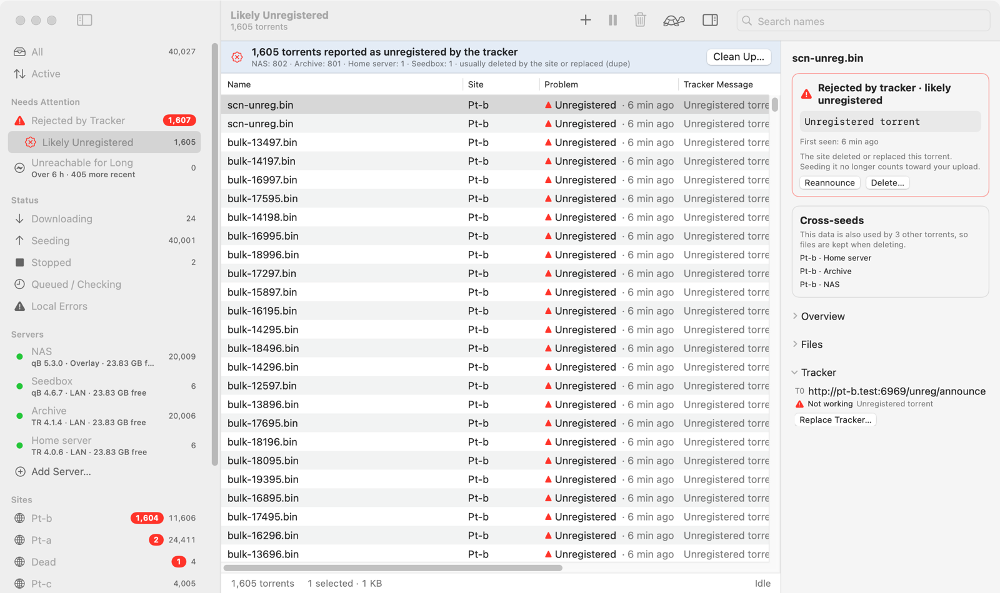
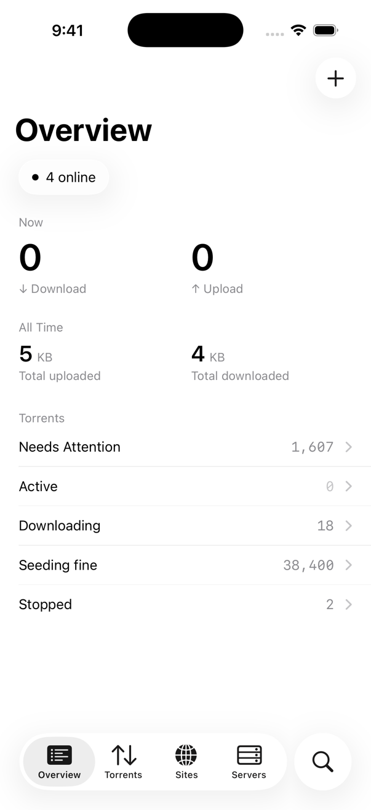
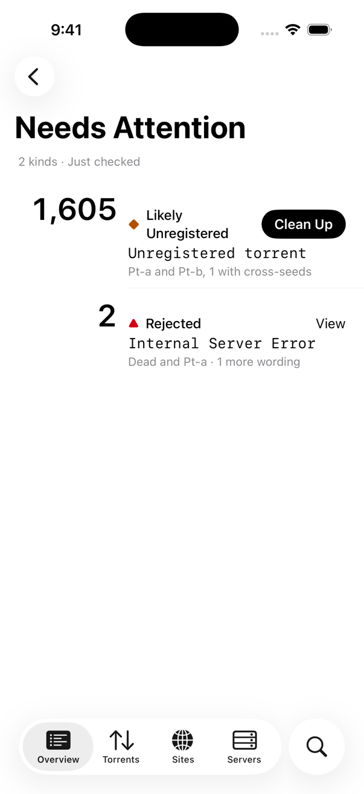
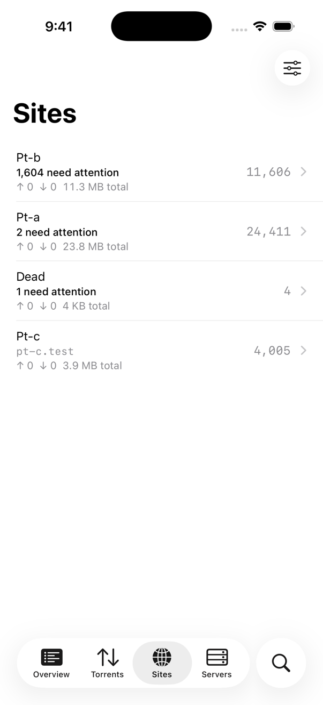
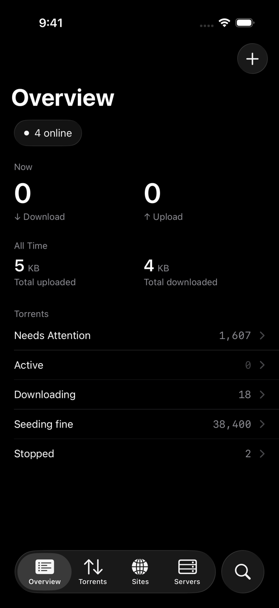

<div align="center">


# Peerdeck

**A qBittorrent, Transmission and Flood remote for macOS and iOS**

English · [简体中文](README.zh-CN.md)

[](#installation)
[](#homebrew)
[](#altstore--sidestore)
[](LICENSE)

</div>

Once you run a few download clients, it gets hard to notice which torrents a site deleted or which tracker stopped responding. Peerdeck puts the torrents from all your qBittorrent, Transmission and Flood servers in one list and shows you those problems, so you can deal with them in one place.

It's a remote: it connects straight to the clients you already run, with no server in between, and doesn't download or seed by itself. Peerdeck is an independent project and isn't affiliated with qBittorrent, Transmission or Flood.



<table>
  <tr>
    <td></td>
    <td></td>
    <td></td>
    <td></td>
  </tr>
</table>

## Features

### Deal with tracker problems

- See rejected, likely unregistered and long-unreachable torrents, grouped by the tracker's own message.
- Clean up unregistered torrents in one step. Torrents that share data with others are kept, and each one is checked again before it's removed.
- Change your mind: deletes wait 10 seconds before they run.
- On the Mac, replace tracker domains or passkeys in bulk, with undo.

### Manage torrents

- Filter by state, activity, server, site, category or tag, or search by name.
- Add magnet links, `.torrent` files and URLs, set a default server for each site, and choose which files to download once they're added.
- See problems, uploaded, downloaded and total size for each site.
- On the Mac, check speeds and problems from the menu bar, and get notified when downloads finish.

### Connect your way

- Give a server several routes (LAN, overlay network, DDNS, reverse proxy) in order of priority.
- Trust self-signed certificates by fingerprint. Credentials are stored in the Keychain.
- Use it in English or Simplified Chinese. On iOS 26 it uses Liquid Glass, with a fallback for earlier versions.

> [!WARNING]
> Deleting files can't be undone after the 10-second window. Peerdeck recognizes shared data by infohash or name, so it **can't detect renamed cross-seeds, torrents that share only some files, or clients you haven't added**. It keeps files whenever one of your servers is offline, turned off or can't be checked.

Tested with qBittorrent 4.6 and 5.3, and Transmission 4.0 and 4.1, with up to 20,000 torrents on one server.

### Flood

Peerdeck also connects to [Flood](https://github.com/jesec/flood), which is the way to use it with rTorrent. Tested with Flood 4.16.4. Choose **Flood** when adding a server and enter the address and account you use for its web UI.

| Behind Flood | Tracker problems and cleanup | Notes |
|---|---|---|
| rTorrent | Yes | Tracker warnings aren't reported. A failure on a torrent with several sites only counts as a warning. |
| Transmission | Yes | |
| qBittorrent | No | Flood caches tracker messages for up to an hour. Connect to qBittorrent directly instead. |
| Deluge, Neptune | No | Not tested. |

- Categories, alternative and per-torrent speed limits, all-time totals, seeding time and tracker replacement aren't available through Flood.
- With rTorrent, Flood itself moves and deletes files, so it must see them at the same paths as rTorrent. Otherwise it changes or removes the torrent and silently leaves the files behind.
- A reverse proxy in front of Flood must not buffer `/api/activity-stream`.

## Installation

### Homebrew

Requires macOS 15 or later (Apple Silicon and Intel).

```bash
brew tap xheiop/peerdeck https://github.com/xheiop/Peerdeck
brew install --cask xheiop/peerdeck/peerdeck
```

To update:

```bash
brew update && brew upgrade --cask peerdeck
```

Then follow [First launch on macOS](#first-launch-on-macos).

### Manual download

Download `Peerdeck-x.y.z.dmg` from [Releases](https://github.com/xheiop/Peerdeck/releases/latest), open it, and drag Peerdeck into Applications.

### First launch on macOS

Peerdeck is ad-hoc signed and not notarized, so macOS blocks it the first time, whichever way you installed it:

1. Open Peerdeck and dismiss the warning.
2. Go to **System Settings → Privacy & Security** and click **Open Anyway**.

Or remove the quarantine flag yourself:

```bash
xattr -dr com.apple.quarantine /Applications/Peerdeck.app
```

After an update, macOS may also ask again for access to your saved servers in the Keychain.

### iOS / iPadOS (sideload)

Every release ships an **unsigned** `Peerdeck-x.y.z-unsigned.ipa` for iOS 17 and later.

| Your device | Use | Updates |
|---|---|---|
| iOS 17 or later | [AltStore Classic](https://altstore.io) or [SideStore](https://sidestore.io) | Through the source below |
| iOS 17.0 exactly | [TrollStore](https://github.com/opa334/TrollStore) | Install the new ipa over the old one |
| iOS 17 or later | [Sideloadly](https://sideloadly.io) or another signing tool | Install the new ipa over the old one |

#### AltStore / SideStore

Add this source in the **Sources** tab, then install Peerdeck from it. New releases show up as updates.

```text
https://github.com/xheiop/Peerdeck/releases/latest/download/altstore.json
```

AltStore PAL is not supported, because it only installs notarized apps. With a free Apple ID, apps have to be refreshed every 7 days.

#### TrollStore

TrollStore does not support iOS 17.0.1 or later, and Peerdeck needs iOS 17, so this works on **iOS 17.0 only**. Download the ipa from [Releases](https://github.com/xheiop/Peerdeck/releases/latest) and open it in TrollStore.

#### Sideloading limitation

The unsigned ipa carries no App Group or shared Keychain entitlements, so **the share extension can't see the servers saved in the app**. Add torrents inside Peerdeck, or tap a magnet link to open it there.

## Building

Requires macOS 15+, Xcode 26+, and [XcodeGen](https://github.com/yonaskolb/XcodeGen) for the iOS project (`brew install xcodegen`).

```bash
App/scripts/build-mac.sh                      # build Peerdeck.app and print its path
(cd iOS && xcodegen)                          # generate iOS/Peerdeck.xcodeproj
swift test --package-path Packages/TorrentKit # test the client library
scripts/build-dmg.sh                          # package the universal dmg
scripts/build-ipa.sh                          # package the unsigned ipa
```

Build outputs go to `~/Library/Caches/transclient-build`; set `TC_BUILD_DIR` to change that. To run on an iPhone from Xcode, set `DEVELOPMENT_TEAM` in `iOS/project.yml` and register the App Group `group.dev.peerdeck`.

<details>
<summary>Local test servers</summary>

`dev/compose.yaml` starts qBittorrent, Transmission, a fake tracker and an HTTPS reverse proxy on `127.0.0.1`. The credentials in `dev/` are for these containers only.

```bash
docker compose -f dev/compose.yaml up -d
python3 dev/bootstrap.py
python3 dev/seed.py trackers
TC_CONFIG_FILE="$PWD/dev/app-servers.json" ~/Library/Caches/transclient-build/Peerdeck.app/Contents/MacOS/Peerdeck
```

</details>

<details>
<summary>Translations</summary>

English strings in the code are the localization keys. Put Chinese translations in `App/scripts/i18n_zh.py`, then run `App/scripts/i18n.sh`.

</details>

<details>
<summary>Releasing</summary>

1. Add a `## [x.y.z] - YYYY-MM-DD` section to [CHANGELOG.md](CHANGELOG.md) and commit it.
2. Push the branch, then the tag:

   ```bash
   git push origin main
   git tag vX.Y.Z
   git push origin vX.Y.Z
   ```

3. The [Release workflow](.github/workflows/release.yml) tests, builds, and publishes the dmg, ipa, checksums and `altstore.json`, then commits `Casks/peerdeck.rb` to the default branch.
4. Run `git pull` to get that commit.

Tags with a suffix, such as `v0.2.0-beta.1`, become pre-releases and leave Homebrew and AltStore untouched.

</details>

## Project layout

| Path | Contents |
|---|---|
| `App/` | macOS app, plus the model layer shared with iOS |
| `iOS/` | iOS app and share extension |
| `Packages/TorrentKit/` | qBittorrent, Transmission and Flood client library, with no third-party dependencies |
| `scripts/` | Release packaging, Homebrew cask, AltStore source |
| `dev/` | Local test servers |
| `assets/` | Icon and screenshots |

## Credits

- [qBittorrent](https://github.com/qbittorrent/qBittorrent) and [Transmission](https://github.com/transmission/transmission): the clients Peerdeck controls, and their remote APIs
- [XcodeGen](https://github.com/yonaskolb/XcodeGen): generates the iOS project

## License

Copyright © 2026 xheiop

Peerdeck is free software, licensed under the [GNU General Public License v3.0 only](LICENSE) (`GPL-3.0-only`). It comes without any warranty.
