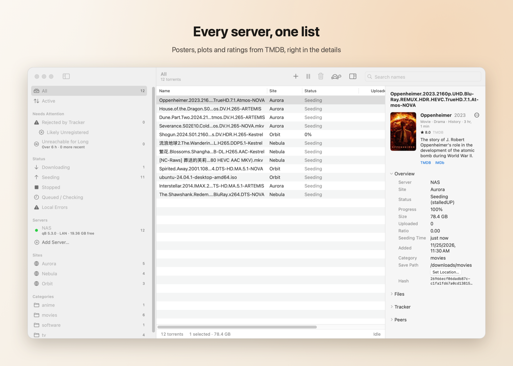
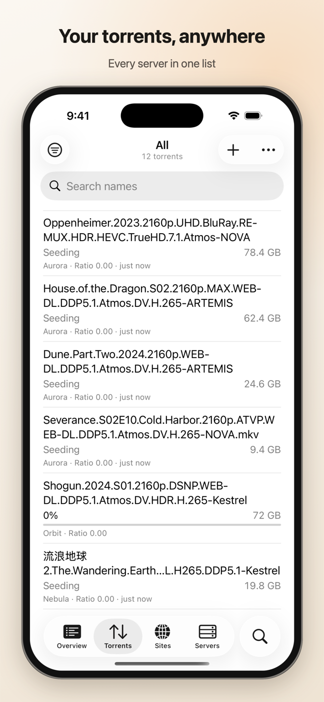
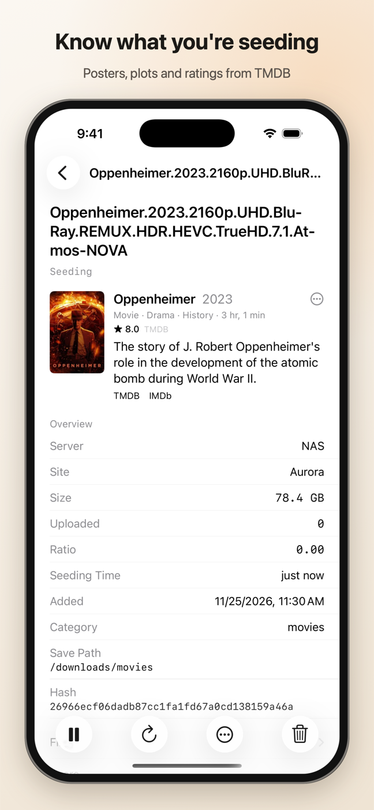

<div align="center">


# Peerdeck

**A native qBittorrent, Transmission and Flood remote for macOS and iOS**

English · [简体中文](README.zh-CN.md)

[](#installation)
[](#macos)
[](#ios)
[](LICENSE)

</div>

Manage your qBittorrent, Transmission and Flood servers from your Mac, iPhone or iPad, without keeping a browser tab open for each one.

Peerdeck puts the torrents from all your servers in one list, so you can watch speeds, filter, add, pause and delete in one place instead of switching between web UIs. It connects straight to the clients you already run, with no server in between, and doesn't download or seed by itself.



<table>
  <tr>
    <td></td>
    <td></td>
  </tr>
</table>

## Who it's for

- You run qBittorrent, Transmission or Flood on a NAS, VPS, seedbox or home server, and more than one of them.
- You use private trackers, cross-seed, and need a safe way to find and clean up dead torrents.
- You want native Mac and iPhone apps, not another web UI.

## Who it's not for

- You download the occasional torrent and don't run a server of your own.
- You want an app that downloads and seeds by itself. Peerdeck only controls the clients you already run.
- You want a one-tap App Store install. On iOS it can only be sideloaded for now; see [Installation](#ios).

## Features

### Built for private trackers

- See torrents, uploaded, downloaded and total size for each site.
- Torrents the site deleted, that a tracker rejects, or that can't reach their tracker are listed on their own, ready to clean up in one go. Data still used by cross-seeds is kept (matched by infohash or name, so renamed cross-seeds aren't recognized).
- Replace tracker domains or passkeys in bulk on the Mac.
- Set a default server for each site.

### All your servers in one list

- Filter torrents from every server by state, activity, server, site, category or tag, or search by name.
- Start, pause, recheck, reannounce and delete in bulk.
- See each server's speed and free space, and toggle alternative speed limits.
- Add magnet links, `.torrent` files and URLs, and choose which files to download once they're added.

### Know what each torrent is

- Open a torrent's details to see which movie or show it is, worked out from its name: poster, plot, rating and genres, plus the season for TV.
- Info comes from TMDB in the app's language, with links to TMDB and IMDb (and Douban in Chinese).
- Fix a wrong match by searching yourself; torrents with the same name, cross-seeds included, follow the fix.
- Off by default. When on, torrent names are sent to TMDB to look them up, using the built-in key or your own.

### Also on the Mac

- Change category, tags, per-torrent upload limit and save location, and adjust global speed limits.
- Check speeds from the menu bar and get notified when downloads finish.

### Direct connection, no server in between

- Give a server several addresses (LAN, overlay network, DDNS, reverse proxy), tried in order of priority.
- Self-signed certificates work. Credentials are stored in the Keychain.
- English and Simplified Chinese. Liquid Glass on iOS 26+.

## Supported clients

| Client | Tested versions |
|---|---|
| qBittorrent | 4.6, 5.3 |
| Transmission | 4.0, 4.1 |
| [Flood](https://github.com/jesec/flood) | 4.16, with rTorrent or Transmission behind it |

Tested with up to 20,000 torrents on one server.

Tracker problems can't be detected when Flood runs on qBittorrent, so connect to qBittorrent directly. Categories, alternative and per-torrent speed limits, and tracker replacement aren't available through Flood.

## Installation

### macOS

Requires macOS 15 or later, on Apple Silicon or Intel.

```bash
brew tap xheiop/peerdeck https://github.com/xheiop/Peerdeck
brew install --cask xheiop/peerdeck/peerdeck
```

Or download the dmg from [Releases](https://github.com/xheiop/Peerdeck/releases/latest) and drag Peerdeck into Applications.

Peerdeck isn't notarized, so macOS blocks it the first time. Open it once, then go to **System Settings → Privacy & Security** and click **Open Anyway**.

### iOS

Requires iOS 17 or later.

The easiest way is [AltStore](https://altstore.io) or [SideStore](https://sidestore.io). Add this source, and new versions will show up as updates:

```text
https://github.com/xheiop/Peerdeck/releases/latest/download/altstore.json
```

You can also download the ipa from [Releases](https://github.com/xheiop/Peerdeck/releases/latest) and install it with Sideloadly or another signing tool. On iOS 17.0, install the `.tipa` from Releases with [TrollStore](https://github.com/opa334/TrollStore).

## Building

Requires macOS 15+, Xcode 26+, and [XcodeGen](https://github.com/yonaskolb/XcodeGen) for the iOS project (`brew install xcodegen`).

```bash
App/scripts/build-mac.sh                      # build Peerdeck.app and print its path
(cd iOS && xcodegen)                          # generate iOS/Peerdeck.xcodeproj
swift test --package-path Packages/TorrentKit # test the client library
scripts/build-dmg.sh                          # package the universal dmg
scripts/build-ipa.sh                          # package the unsigned ipa and the TrollStore tipa
```

Build outputs go to `~/Library/Caches/transclient-build`; set `TC_BUILD_DIR` to change that. To run on an iPhone from Xcode, set `DEVELOPMENT_TEAM` in `iOS/project.yml` and register the App Group `group.dev.peerdeck`.

<details>
<summary>Local test servers</summary>

`dev/compose.yaml` starts qBittorrent, Transmission, a fake tracker and an HTTPS reverse proxy on `127.0.0.1`. The credentials in `dev/` are for these containers only.

```bash
docker compose -f dev/compose.yaml up -d
python3 dev/bootstrap.py
python3 dev/seed.py trackers
TC_CONFIG_FILE="$PWD/dev/app-servers.json" ~/Library/Caches/transclient-build/Peerdeck.app/Contents/MacOS/Peerdeck
```

</details>

<details>
<summary>Translations</summary>

English strings in the code are the localization keys. Put Chinese translations in `App/scripts/i18n_zh.py`, then run `App/scripts/i18n.sh`.

</details>

## Project layout

| Path | Contents |
|---|---|
| `App/` | macOS app, plus the model layer shared with iOS |
| `iOS/` | iOS app and share extension |
| `Packages/TorrentKit/` | qBittorrent, Transmission and Flood client library, with no third-party dependencies |
| `scripts/` | Release packaging, Homebrew cask, AltStore source |
| `dev/` | Local test servers |
| `assets/` | Icon and screenshots |

## Credits

- [qBittorrent](https://github.com/qbittorrent/qBittorrent), [Transmission](https://github.com/transmission/transmission) and [Flood](https://github.com/jesec/flood): the clients Peerdeck controls, and their remote APIs
- [XcodeGen](https://github.com/yonaskolb/XcodeGen): generates the iOS project

## License

Copyright © 2026 xheiop

Peerdeck is free and open source, licensed under [GPL-3.0-only](LICENSE). It's an independent project, not affiliated with qBittorrent, Transmission or Flood.
