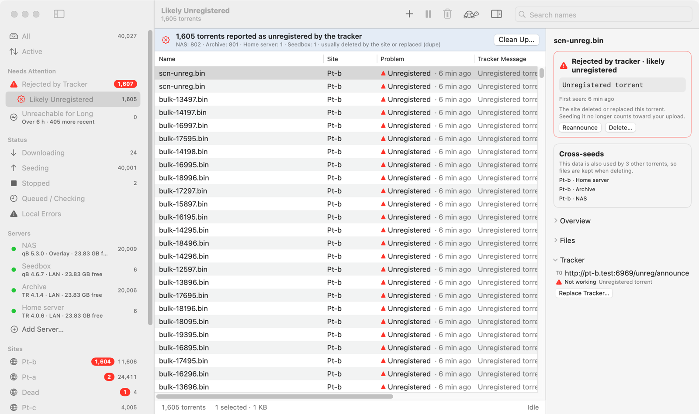
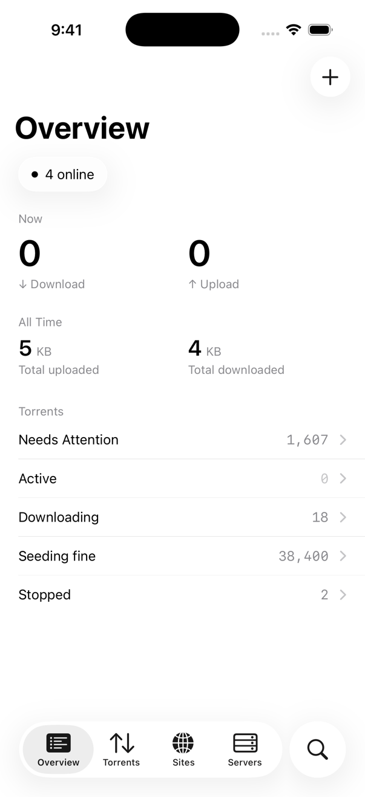
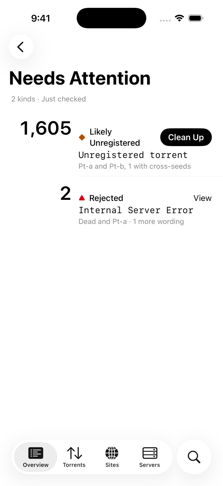
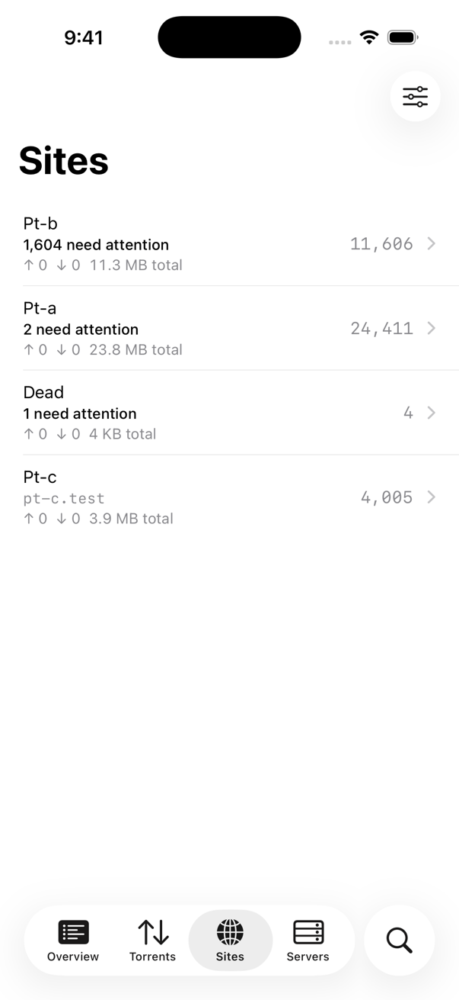
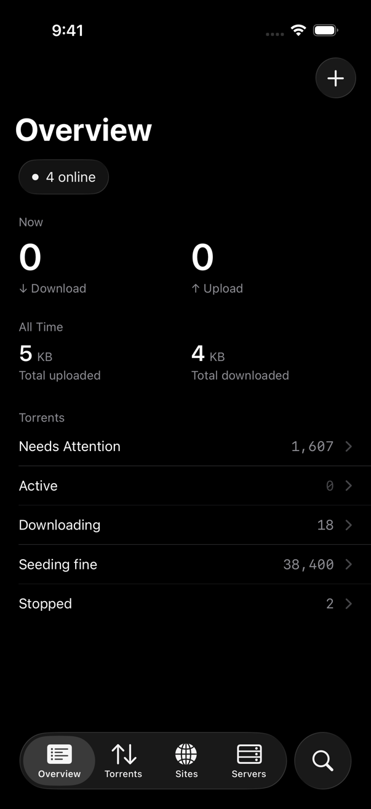

<div align="center">


# Peerdeck

**macOS 和 iOS 上的 qBittorrent / Transmission / Flood 遥控器**

[English](README.md) · 简体中文

[](#安装)
[](#homebrew)
[](#altstore--sidestore)
[](LICENSE)

</div>

下载器一多，哪些种子被站点删了、哪个 tracker 已经连不上，就很难及时发现。Peerdeck 把所有 qBittorrent、Transmission 和 Flood 里的种子放进一张列表，把这些问题找出来，让你在一个地方处理完。

它只是遥控器：直接连接你已经在运行的下载器，不经过中间服务器，自己也不下载、不做种。Peerdeck 是独立项目，与 qBittorrent、Transmission、Flood 官方无关。



<table>
  <tr>
    <td></td>
    <td></td>
    <td></td>
    <td></td>
  </tr>
</table>

## 功能

### 处理 tracker 问题

- 列出被拒绝、疑似未注册、长时间连不上的种子，按 tracker 的原话归类。
- 一步清掉未注册的种子，和其他种子共用数据的会保留，删除前会逐个重新核对。
- 删除前有 10 秒可以反悔。
- Mac 上可以批量替换 tracker 域名或 passkey，也能撤销。

### 管理种子

- 按状态、活动、服务器、站点、分类、标签筛选，或者按名称搜索。
- 添加磁力链接、`.torrent` 文件和种子链接，可以给每个站点设默认服务器，添加后可以选要下载哪些文件。
- 查看每个站点的问题数、上传、下载和总体积。
- Mac 上可以在菜单栏看速度和问题，下载完成时会收到通知。

### 连接下载器

- 一台下载器可以配内网、组网、DDNS、反向代理多条线路，按优先级选用。
- 自签证书可以按指纹信任，账号密码存在钥匙串里。
- 支持英文和简体中文。iOS 26 上是 Liquid Glass 样式，更早的系统会自动降级。

> [!WARNING]
> 10 秒撤销时间一过，删掉的文件无法恢复。Peerdeck 按 infohash 或名字识别共用的数据，所以**认不出改过名字的辅种、只有部分文件相同的种子，以及没添加进来的下载器**。只要有一台下载器离线、停用或没法核对，就只删种子、保留文件。

测试过 qBittorrent 4.6、5.3 和 Transmission 4.0、4.1，单台最多测到 2 万个种子。

### Flood

Peerdeck 也可以连接 [Flood](https://github.com/jesec/flood)，用 rTorrent 的走这条路。测试过 Flood 4.16.4。添加服务器时选 **Flood**，填它网页的地址和账号。

| Flood 后面接的 | tracker 问题和清理 | 说明 |
|---|---|---|
| rTorrent | 支持 | 看不到 tracker 警告。挂了多个站的种子报错时只算警告。 |
| Transmission | 支持 | |
| qBittorrent | 不支持 | Flood 会把 tracker 报错缓存最长一小时，请直连 qBittorrent。 |
| Deluge、Neptune | 不支持 | 没有测试过。 |

- 经过 Flood 时没有分类、备用限速、单种限速、历史总量、做种时间，也不能替换 tracker。
- 接 rTorrent 时，移动和删除文件是 Flood 自己做的，它看到的路径必须和 rTorrent 一致。否则它只会改掉或删掉种子，文件原地不动，而且不报错。
- Flood 前面的反代不能缓冲 `/api/activity-stream`。

## 安装

### Homebrew

需要 macOS 15 或更高版本（Apple 芯片和 Intel 都支持）。

```bash
brew tap xheiop/peerdeck https://github.com/xheiop/Peerdeck
brew install --cask xheiop/peerdeck/peerdeck
```

更新：

```bash
brew update && brew upgrade --cask peerdeck
```

装好后按 [macOS 首次打开](#macos-首次打开) 操作。

### 手动下载

到 [Releases](https://github.com/xheiop/Peerdeck/releases/latest) 下载 `Peerdeck-x.y.z.dmg`，打开后把 Peerdeck 拖进「应用程序」。

### macOS 首次打开

Peerdeck 是 ad-hoc 签名，没有公证，不管用哪种方式安装，第一次打开都会被 macOS 拦下：

1. 打开一次 Peerdeck，关掉警告。
2. 到 **系统设置 → 隐私与安全性**，点 **仍要打开**。

也可以自己去掉隔离属性：

```bash
xattr -dr com.apple.quarantine /Applications/Peerdeck.app
```

更新以后，macOS 可能会再问一次是否允许读取钥匙串里保存的服务器。

### iOS / iPadOS（侧载）

每个版本都附带一个**未签名**的 `Peerdeck-x.y.z-unsigned.ipa`，支持 iOS 17 及以上。

| 你的设备 | 用什么装 | 怎么更新 |
|---|---|---|
| iOS 17 及以上 | [AltStore Classic](https://altstore.io) 或 [SideStore](https://sidestore.io) | 通过下面的源更新 |
| 仅 iOS 17.0 | [TrollStore（巨魔）](https://github.com/opa334/TrollStore) | 用新 ipa 覆盖安装 |
| iOS 17 及以上 | [Sideloadly](https://sideloadly.io) 或其他签名工具 | 用新 ipa 覆盖安装 |

#### AltStore / SideStore

在 **Sources（源）** 里添加下面的地址，再从里面安装 Peerdeck。之后有新版本会出现在更新列表里。

```text
https://github.com/xheiop/Peerdeck/releases/latest/download/altstore.json
```

不支持 AltStore PAL，它只能安装经过公证的 app。用免费 Apple ID 时，每 7 天要刷新一次。

#### TrollStore

巨魔不支持 iOS 17.0.1 及以上，而 Peerdeck 最低要 iOS 17，所以**只有 iOS 17.0 能用巨魔安装**。到 [Releases](https://github.com/xheiop/Peerdeck/releases/latest) 下载 ipa，用巨魔打开即可。

#### 侧载的限制

未签名的 ipa 不带 App Group 和共享钥匙串权限，所以**分享扩展读不到 app 里保存的服务器**。请在 Peerdeck 里添加种子，或者点磁力链接跳转到 app 里添加。

## 构建

需要 macOS 15+、Xcode 26+；iOS 工程还需要 [XcodeGen](https://github.com/yonaskolb/XcodeGen)（`brew install xcodegen`）。

```bash
App/scripts/build-mac.sh                      # 构建 Peerdeck.app 并输出路径
(cd iOS && xcodegen)                          # 生成 iOS/Peerdeck.xcodeproj
swift test --package-path Packages/TorrentKit # 测试客户端库
scripts/build-dmg.sh                          # 打通用架构的 dmg
scripts/build-ipa.sh                          # 打未签名的 ipa
```

构建产物放在 `~/Library/Caches/transclient-build`，可以用 `TC_BUILD_DIR` 修改。要用 Xcode 装到 iPhone 上，先在 `iOS/project.yml` 里填 `DEVELOPMENT_TEAM`，并登记 App Group `group.dev.peerdeck`。

<details>
<summary>本地测试用的下载器</summary>

`dev/compose.yaml` 会在 `127.0.0.1` 上启动 qBittorrent、Transmission、一个假 tracker 和一个 HTTPS 反向代理。`dev/` 里的账号密码只用于这些容器。

```bash
docker compose -f dev/compose.yaml up -d
python3 dev/bootstrap.py
python3 dev/seed.py trackers
TC_CONFIG_FILE="$PWD/dev/app-servers.json" ~/Library/Caches/transclient-build/Peerdeck.app/Contents/MacOS/Peerdeck
```

</details>

<details>
<summary>翻译</summary>

代码里的英文原文就是本地化的键。中文译文写在 `App/scripts/i18n_zh.py`，改完运行 `App/scripts/i18n.sh`。

</details>

<details>
<summary>发版</summary>

1. 在 [CHANGELOG.md](CHANGELOG.md) 里加一节 `## [x.y.z] - YYYY-MM-DD` 并提交。
2. 先推分支，再推 tag：

   ```bash
   git push origin main
   git tag vX.Y.Z
   git push origin vX.Y.Z
   ```

3. [Release workflow](.github/workflows/release.yml) 会测试、构建，发布 dmg、ipa、校验文件和 `altstore.json`，然后把 `Casks/peerdeck.rb` 提交到默认分支。
4. 运行 `git pull` 拉回这个提交。

带后缀的 tag（比如 `v0.2.0-beta.1`）会发成预发布，不影响 Homebrew 和 AltStore。

</details>

## 项目结构

| 路径 | 内容 |
|---|---|
| `App/` | macOS app，以及和 iOS 共用的 Model 层 |
| `iOS/` | iOS app 和分享扩展 |
| `Packages/TorrentKit/` | qBittorrent、Transmission 和 Flood 客户端库，没有第三方依赖 |
| `scripts/` | 发布打包、Homebrew cask、AltStore 源 |
| `dev/` | 本地测试用的下载器 |
| `assets/` | 图标和截图 |

## 致谢

- [qBittorrent](https://github.com/qbittorrent/qBittorrent) 和 [Transmission](https://github.com/transmission/transmission)：Peerdeck 遥控的下载器，以及它们的远程接口
- [XcodeGen](https://github.com/yonaskolb/XcodeGen)：生成 iOS 工程

## 许可证

Copyright © 2026 xheiop

Peerdeck 是自由软件，以 [GNU 通用公共许可证第 3 版](LICENSE)（`GPL-3.0-only`）发布，不提供任何担保。
