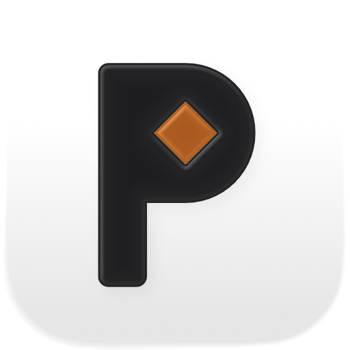
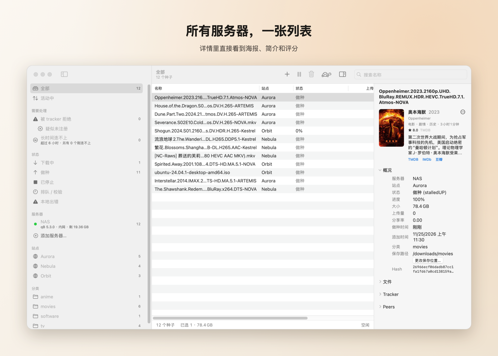
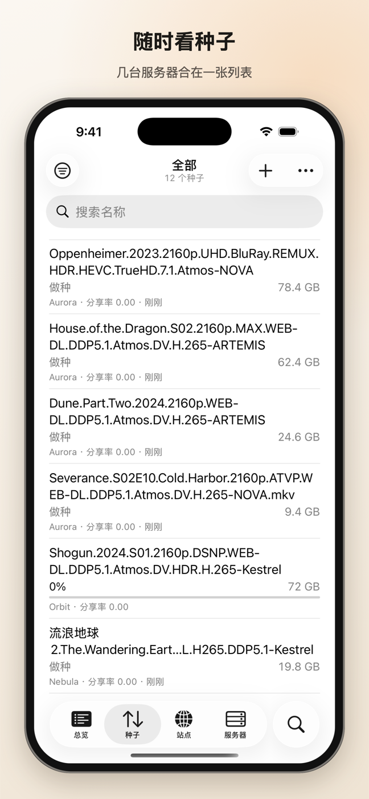
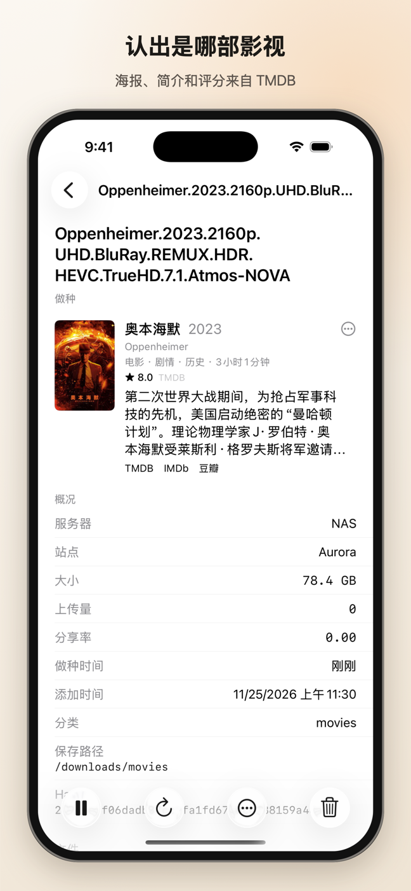

<div align="center">



# Peerdeck

**macOS 和 iOS 原生 qBittorrent、Transmission、Flood 遥控**

[English](README.md) · 简体中文

[](#安装)
[](#macos)
[](#ios)
[](LICENSE)

</div>

在 Mac、iPhone、iPad 上管理你的 qBittorrent、Transmission、Flood 服务器，不用每个服务器开一个浏览器标签页。

几台下载器的种子合在一张列表里，看速度、筛选、添加、暂停、删除都在一个地方做完，不用在几个网页之间来回切。Peerdeck 直接连接你已经在运行的下载器，不经过中间服务器，自己不下载也不做种。



<table>
  <tr>
    <td></td>
    <td></td>
  </tr>
</table>

## 适合谁

- 在 NAS、VPS、Seedbox 或家里服务器上跑 qBittorrent、Transmission 或 Flood，而且不止一台。
- 玩 PT，跨站做种，需要安全地找出并清理失效种。
- 想要原生 Mac 和 iPhone 应用，而不是又一个网页后台。

## 不适合谁

- 只是偶尔下载一个种子，没有自己的服务器。
- 想找一个自己下载、自己做种的应用。Peerdeck 只遥控你已有的客户端。
- 想要 App Store 一键安装。iOS 目前只能侧载，见[安装](#ios)。

## 功能

### 为 PT 做的

- 按站点看种子、上传、下载和总大小。
- 被站点删除、被 Tracker 拒绝、连不上 Tracker 的种子单独列出，可以一键清理。交叉做种仍在用的数据会保留（按 infohash 或名字匹配，改过名的交叉种认不出来）。
- Mac 上批量替换 Tracker 域名或 passkey。
- 每个站点可以设默认服务器。

### 所有服务器，一个列表

- 按状态、活跃度、服务器、站点、分类、标签过滤所有服务器的种子，或按名字搜索。
- 批量开始、暂停、重新校验、重新汇报、删除。
- 看每台服务器的速度和剩余空间，切换备用限速。
- 添加磁力链接、`.torrent` 文件和 URL，添加后选择要下载哪些文件。

### 认出是哪部影视

- 打开种子详情时，按种子名认出是哪部电影或剧集，显示海报、简介、评分和类型；剧集会显示是第几季。
- 资料来自 TMDB，界面是中文时显示中文资料，可以跳到 TMDB、IMDb 和豆瓣。
- 认错了可以手动搜索改正，同名的种子一起改。
- 默认关闭。开启后种子名会发给 TMDB 查询，可以用内置的密钥，也可以填你自己的。

### Mac 上还可以

- 改分类、标签、单个种子的上传限速和保存位置，调整全局限速。
- 菜单栏看速度，下载完成时收到通知。

### 直连，没有中间服务器

- 一台服务器可以填多个地址（局域网、组网、DDNS、反代），按优先级尝试。
- 支持自签证书，账号密码存在钥匙串里。
- 中文和英文，iOS 26+ 支持 Liquid Glass。

## 支持的下载器

| 下载器 | 测试过的版本 |
|---|---|
| qBittorrent | 4.6、5.3 |
| Transmission | 4.0、4.1 |
| [Flood](https://github.com/jesec/flood) | 4.16，后端为 rTorrent 或 Transmission |

单台下载器测试到 2 万个种子。

Flood 接 qBittorrent 时测不出 Tracker 问题，请直接连 qBittorrent。分类、备用限速、单个种子限速和 Tracker 替换在 Flood 下不可用。

## 安装

### macOS

需要 macOS 15 或更高，Apple Silicon 或 Intel 都可以。

```bash
brew tap xheiop/peerdeck https://github.com/xheiop/Peerdeck
brew install --cask xheiop/peerdeck/peerdeck
```

也可以从 [Releases](https://github.com/xheiop/Peerdeck/releases/latest) 下载 dmg，拖到“应用程序”里。

Peerdeck 没有经过公证，macOS 第一次会拦截。打开一次，然后去**系统设置 → 隐私与安全性**，点**仍要打开**。

### iOS

需要 iOS 17 或更高。

最方便的是 [AltStore](https://altstore.io) 或 [SideStore](https://sidestore.io)。添加下面这个源，以后的新版本会出现在更新列表里：

```text
https://github.com/xheiop/Peerdeck/releases/latest/download/altstore.json
```

也可以从 [Releases](https://github.com/xheiop/Peerdeck/releases/latest) 下载 ipa，用 Sideloadly 或其他签名工具安装。iOS 17.0 可以用 [TrollStore](https://github.com/opa334/TrollStore) 安装 Releases 里的 `.tipa`。

## 构建

需要 macOS 15+、Xcode 26+，iOS 项目需要 [XcodeGen](https://github.com/yonaskolb/XcodeGen)（`brew install xcodegen`）。

```bash
App/scripts/build-mac.sh                      # 构建 Peerdeck.app 并打印路径
(cd iOS && xcodegen)                          # 生成 iOS/Peerdeck.xcodeproj
swift test --package-path Packages/TorrentKit # 测试客户端库
scripts/build-dmg.sh                          # 打包通用 dmg
scripts/build-ipa.sh                          # 打包未签名 ipa 和 TrollStore 用的 tipa
```

构建产物放在 `~/Library/Caches/transclient-build`，可以用 `TC_BUILD_DIR` 修改。要用 Xcode 装到 iPhone 上，先在 `iOS/project.yml` 里填 `DEVELOPMENT_TEAM`，并登记 App Group `group.dev.peerdeck`。

<details>
<summary>本地测试用的下载器</summary>

`dev/compose.yaml` 会在 `127.0.0.1` 上启动 qBittorrent、Transmission、一个假 tracker 和一个 HTTPS 反向代理。`dev/` 里的账号密码只用于这些容器。

```bash
docker compose -f dev/compose.yaml up -d
python3 dev/bootstrap.py
python3 dev/seed.py trackers
TC_CONFIG_FILE="$PWD/dev/app-servers.json" ~/Library/Caches/transclient-build/Peerdeck.app/Contents/MacOS/Peerdeck
```

</details>

<details>
<summary>翻译</summary>

代码里的英文字符串就是本地化 key。中文翻译放在 `App/scripts/i18n_zh.py`，然后运行 `App/scripts/i18n.sh`。

</details>

## 项目结构

| 路径 | 内容 |
|---|---|
| `App/` | macOS app，以及和 iOS 共用的 Model 层 |
| `iOS/` | iOS app 和分享扩展 |
| `Packages/TorrentKit/` | qBittorrent、Transmission 和 Flood 客户端库，没有第三方依赖 |
| `scripts/` | 发布打包、Homebrew cask、AltStore 源 |
| `dev/` | 本地测试用的下载器 |
| `assets/` | 图标和截图 |

## 致谢

- [qBittorrent](https://github.com/qbittorrent/qBittorrent)、[Transmission](https://github.com/transmission/transmission) 和 [Flood](https://github.com/jesec/flood)：Peerdeck 控制的客户端及其远程 API
- [XcodeGen](https://github.com/yonaskolb/XcodeGen)：生成 iOS 项目

## 许可证

Copyright © 2026 xheiop

Peerdeck 免费开源，使用 [GPL-3.0-only](LICENSE) 许可证。它是独立项目，与 qBittorrent、Transmission、Flood 官方无关。
